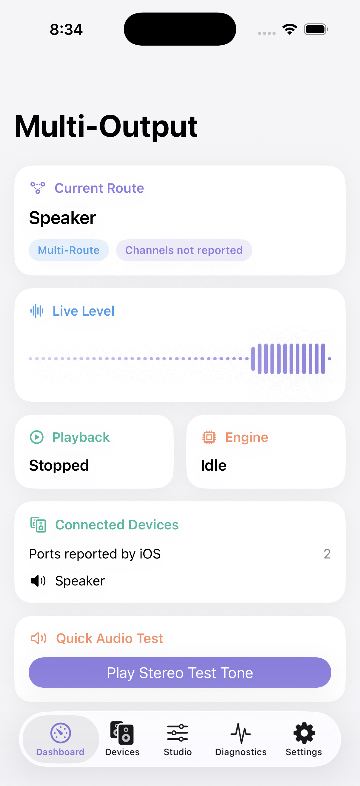
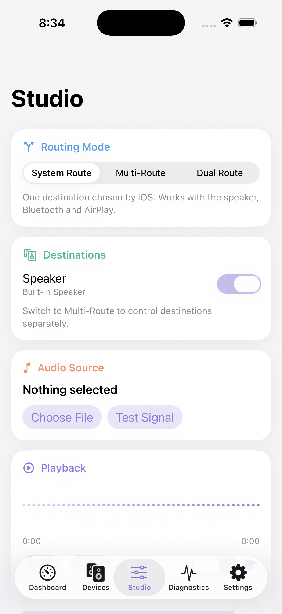

# Multi-Output for iPhone

A native SwiftUI app that brings the idea of the Mac's **Multi-Output Device** to iPhone: one audio stream, played to every output iOS allows at the same time.

It uses only public Apple APIs, shows only what iOS actually reports, and is upfront about what iOS doesn't allow.

| Dashboard | Studio |
|---|---|
|  |  |

> **Status:** builds with Xcode 26.5, 32 unit tests pass, and playback runs in the iOS Simulator. **It hasn't been tested on a physical iPhone yet**, so simultaneous output on real hardware is unconfirmed. Results from real devices are very welcome. See [how to test](docs/05-physical-device-testing.md).

## What it does

- **Three routing modes:** System Route (one output, including Bluetooth and AirPlay), Multi-Route (wired outputs together) and Dual Route (built-in speaker plus a headset, iOS 26.2+).
- **Per-destination routing** through a real output channel map, following Apple's documented multi-route approach.
- **Device discovery** from `AVAudioSession`, with nothing hardcoded.
- **Live level meter** driven by measured audio, so it stays flat when nothing is playing.
- **Test lab:** left, right, stereo, frequency sweep, white noise, latency measurement and route verification. All signals are generated in code.
- **Diagnostics:** sample rate, channels, buffer, latency, interruptions, route-change history and error log.
- **Compatibility log:** record what you actually heard and export it as Markdown.

## What iOS allows

| Combination | Status |
|---|---|
| USB + wired headphones | Documented by Apple |
| USB + HDMI, line out + headphones | Documented by Apple |
| Built-in speaker + wired output (Multi-Route) | Restricted: the speaker is only used when nothing else is connected |
| Built-in speaker + wired or Bluetooth headset (Dual Route) | Documented for iOS 26.2+; Bluetooth is hands-free or LE quality |
| Bluetooth A2DP + anything | Restricted: A2DP can't be enabled in the multi-route category |
| Several Bluetooth headphones at once | Not possible for apps. The Mac can group them, but iOS gives apps no way to do this |
| AirPlay + local output | Not on Apple's eligible list |
| System-wide capture of other apps' audio | Not possible for iOS apps |

Full details are in the [compatibility matrix](docs/03-ios-compatibility-matrix.md).

## Build

Requires Xcode 26 or later. The app runs on iOS 17 and later.

```bash
git clone https://github.com/Roastcoder/ios-multi-output.git
cd ios-multi-output
open MultiOutput.xcodeproj
```

Pick an iPhone or Simulator and press Run. For a physical iPhone, set your signing team and a unique bundle identifier first. See [build and deployment](docs/06-build-and-deploy.md).

Run the tests:

```bash
xcodebuild test -project MultiOutput.xcodeproj -scheme MultiOutput -destination 'platform=iOS Simulator,name=iPhone 17'
```

**[Install page](https://roastcoder.github.io/ios-multi-output/)** has the download, the steps and an output checker. An unsigned IPA is attached to each [release](https://github.com/Roastcoder/ios-multi-output/releases). iPhones won't install it until it's signed, so see [installing from an IPA](docs/06-build-and-deploy.md#installing-from-an-ipa).

## Documentation

1. [Reverse-engineering research report](docs/01-reverse-engineering-report.md)
2. [macOS versus iOS comparison](docs/02-macos-vs-ios.md)
3. [iOS compatibility matrix](docs/03-ios-compatibility-matrix.md)
4. [Technical architecture](docs/04-architecture.md)
5. [Physical-device testing](docs/05-physical-device-testing.md)
6. [Build and deployment](docs/06-build-and-deploy.md)

## Contributing

The most useful contribution right now is a real-device result. Run Route Verification in the Test Lab, export the log and open an issue with your iPhone model, iOS version and accessories.

## License

[MIT](LICENSE). This project isn't affiliated with or endorsed by Apple. Audio MIDI Setup, iPhone, AirPlay and macOS are trademarks of Apple Inc.
